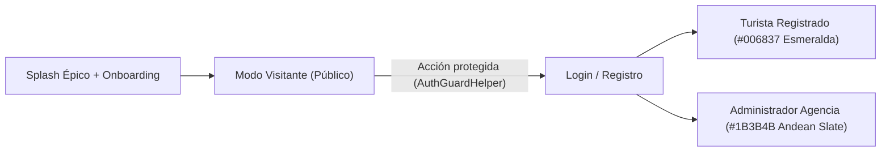

# PerúViajero — Plataforma Móvil Integral de Turismo Formal en el Perú

**Curso:** Desarrollo de Aplicaciones Móviles  
**Institución:** Universidad Tecnológica del Perú (UTP)  
**Empresa / Modelo de Negocio:** *PerúViajero Tours & Travel S.A.C.* (RUC: `20608945123` • Registro MINCETUR)  
**Package Name:** `pe.edu.utp.perviajero`  
**Repositorio GitHub:** [https://github.com/Edisonkz/Per-Viajero](https://github.com/Edisonkz/Per-Viajero)

---

## 1. Datos Generales del Proyecto

| Campo | Detalle |
| :--- | :--- |
| **Aplicación** | **PerúViajero** (Android Nativo — Kotlin + Material Design 3) |
| **Integrantes** | • Kevin Salazar de Jesús<br>• Edison Edgar Sivipaucar Quispe<br>• Gerson Osmar Machuca Abanto |
| **Arquitectura** | Capas desacopladas (`ui/` → `data/repository/` → `services/` + `network/`) con `ServiceLocator` |
| **Compilación** | Debug + Release optimizado con **R8**, `lintVitalRelease` y **31 pruebas unitarias JVM** |

---

## 2. Problemática, Objetivos, Visión y Misión

### Problemática
El turismo en el Perú sufre de información fragmentada (el viajero necesita distintas apps para descubrir atractivos, ver rutas, leer reseñas y reservar), informalidad en las reservas (ausencia de manifiestos de pasajeros con DNI exigidos por MTC/SUTRAN y boletos verificables), conectividad intermitente en sierra y selva, y falta de herramientas móviles para que las agencias gestionen sus reservas y catálogo territorial.

### Objetivo General
Desarrollar una aplicación móvil nativa profesional que unifique la **exploración turística**, **comunidad social multi-foto**, **navegación GPS y brújula offline**, **reserva formal con boleto QR** y un **panel administrativo ejecutivo** con control estricto de roles (RBAC).

### Visión
Ser la plataforma móvil referente del turismo formal y sostenible en el Perú, conectando de forma transparente, segura y sin fricción a viajeros con los destinos y agencias acreditadas de las 25 regiones del país.

### Misión
Ofrecer una experiencia móvil intuitiva y resiliente que acompañe al viajero desde el descubrimiento hasta el embarque certificado con boleto digital QR, dotando a las agencias de turismo de herramientas modernas para operar con orden, trazabilidad y calidad de servicio.

> Para el detalle completo del planeamiento estratégico (SDD), objetivos específicos y trazabilidad curricular, consulta [planeamiento/README.md](planeamiento/README.md).

---

## 3. Roles del Aplicativo y Control de Acceso (RBAC)



| Rol | Identidad Visual | Funcionalidades Habilitadas |
| :--- | :--- | :--- |
| **Visitante (`INVITADO`)** | Esmeralda (`#006837`) | Acceso inmediato al abrir la app: Explorar con filtros por Categoría/Departamento/Provincia, Detalle Hero, Mapa GPS, Brújula Offline, Guía IPERÚ, leer Comunidad (fotos y comentarios) y Bandeja de Avisos públicos. |
| **Turista (`CLIENTE`)** | Esmeralda (`#006837`) | Todo lo de Visitante + Cotizar y Reservar Tour, importar acompañantes desde Contactos, Pasarela de Pagos SSL, Boletos Oficiales con QR, Itinerario Semanal con Calendario, publicar experiencias **multi-foto** (hasta 5 fotos), dar `Útil` y comentar publicaciones. |
| **Administrador (`ADMIN`)** | **Azul Pizarra Ejecutivo (`#1B3B4B`)** | Dashboard con 4 KPIs en vivo, datos fiscales MINCETUR, gestión de Reservas filtradas por Destino/Estado/Buscador, **CRUD de Lugares Turísticos** con selector en cascada **Departamento → Provincia → Distrito (API Ubigeo Perú)**, moderación de Comunidad (publicaciones y comentarios) y Emisor de Alertas Push. |

---

## 4. Credenciales de Testing

Definidas en [`app/src/main/assets/services/usuarios.json`](app/src/main/assets/services/usuarios.json):

| Rol | Usuario | Correo | Contraseña |
| :--- | :--- | :--- | :--- |
| **Turista (`CLIENTE`)** | Kevin Turista | `kevin@peruviajero.pe` | `123456` |
| **Turista (`CLIENTE`)** | Edison Viajero | `edison@peruviajero.pe` | `123456` |
| **Administrador (`ADMIN`)** | Gerson Administrador | `gerson@peruviajero.pe` | `admin123` |

*(También dispone de botones de **Acceso Rápido** en `LoginActivity` y alternancia de rol en el menú lateral para evaluaciones rápidas).*

---

## 5. APIs y Servicios Integrados

| API / Servicio | Endpoint / Tecnología | Propósito |
| :--- | :--- | :--- |
| **API REST de Destinos Turísticos** | `https://raw.githubusercontent.com/Edisonkz/Per-Viajero/main/destinos.json` | Catálogo oficial de destinos del Perú (Retrofit 2 + OkHttp 4 + caché 10 MB + 3 estados: Carga/Éxito/Error). |
| **API Oficial de Ubigeos del Perú** | `https://raw.githubusercontent.com/joseluisq/ubigeos-peru/master/json/{departamentos,provincias,distritos}.json` | Selector en cascada de **25 Departamentos, 196 Provincias y 1,874 Distritos** para el CRUD Admin, con caché local y respaldo offline en `assets/services/ubigeo_peru_fallback.json`. |
| **OSRM Routing API** | `https://router.project-osrm.org/route/v1/driving/...` | Cálculo de rutas viales reales desde la ubicación GPS del usuario (con fallback geodésico Haversine offline). |
| **OpenStreetMap (OSMDroid)** | Tiles públicos OSM (`MAPNIK`) | Mapas interactivos nativos en `MapaRutaActivity` y `RutaDestinoActivity`. |
| **FCM + Simulador Push + WorkManager** | `PeruViajeroMessagingService`, `AvisoPushSimulator`, `RecordatorioViajeWorker` | 4 canales de notificación por prioridad, agrupación `InboxStyle`, `TaskStackBuilder` y Bandeja de Avisos (`🔔`). |
| **Android `ContactsContract`** | `ContentResolver` + `GestorPermisos` (4 estados) | Importación de acompañantes de viaje desde la agenda telefónica con degradación elegante a registro manual. |

---

## 6. Módulos y Funcionalidades Clave

1. **Splash Épico + Bienvenida Inmersiva:** Logo oficial vectorial animado (`SplashActivity`) seguido en el primer inicio por `OnboardingActivity` con degradados dinámicos (*morphing*), parallax 3D y acceso directo a Modo Visitante o Login.
2. **Explorar & Detalle Hero:** Buscador reactivo en vivo, filtros por Categoría, Departamento y Provincia, distancia GPS en tiempo real, clima, mapa vial y brújula por sensores físicos (`CompassView`).
3. **Comunidad Multi-Foto & Comentarios:** Publicación de experiencias con **hasta 5 fotos** (Cámara o Galería múltiple), carrusel deslizable en `DetallePublicacionActivity`, sistema completo de comentarios entre viajeros y moderación exclusiva para `ADMIN`.
4. **Cotizador, Pasarela SSL y Boleto Oficial QR:** Rediseño fiel a los mockups aprobados (`docs/mockups_ux_ui/07..09`), Manifiesto SUTRAN con DNI, tarjeta virtual interactiva / Yape / Plin / CIP y Boarding Pass perforado con QR vectorial (`QrVisualView`).
5. **Bandeja de Avisos Turísticos (`🔔`):** Parseo JSON seguro (`AvisoPayloadParser`), filtros por tipo, acción rápida *"Marcar leído"* y detalle con enlace oficial sanitizado.
6. **Módulo Ejecutivo de Administrador:** Cambio automático de paleta a *Andean Slate* (`#1B3B4B`), gestión de reservas por destino/estado, CRUD de destinos con API Ubigeo Perú y emisión de alertas Push.
7. **Soporte Light & Dark Mode + Edge-to-Edge:** Adaptación completa a tema claro/oscuro y barras del sistema (Android 15/16).

---

## 7. Estructura del Proyecto

```text
Per-Viajero/
├── README.md                                  # Documentación principal del repositorio
├── planeamiento/                              # Planeamiento estratégico SDD y roadmap S10–S16
│   └── README.md
├── docs/
│   ├── mockups_ux_ui/                         # Mockups aprobados (01..09) y logo oficial
│   ├── checklists_terminados/                 # Checklists completados (Fases A–N)
│   └── checklists_pendientes/                 # Checklist administrativo de Google Play Console
└── app/src/main/
    ├── assets/services/                       # Semillas JSON (avisos, comunidad, itinerario, reservas, ubigeo, usuarios)
    └── java/pe/edu/utp/perviajero/
        ├── MainActivity.kt                    # Shell curvo 5 tabs + Drawer + paleta dinámica por rol
        ├── di/ServiceLocator.kt               # Composición e inyección de dependencias
        ├── ui/                                # Splash, Onboarding, Explorar, Comunidad, DetallePublicacion,
        │                                      # ReservaTour, MisReservas, Itinerario, BandejaAvisos, AdminDashboard, AdminCatalogo
        ├── ui/common/                         # AuthGuardHelper, VoucherDialogHelper
        ├── ui/view/                           # CurvedBottomBarView, DrawerHeaderBgView, CompassView, QrVisualView
        ├── data/{model,repository,local}/     # Modelos, contratos Repository y PreferencesHelper
        ├── services/                          # AvisoService, ComunidadService, DestinoService, UbigeoPeruService, etc.
        ├── network/                           # ApiClient, TourismApiService, UbigeoApiService, OsrmApiService, FCM
        ├── adapter/                           # ListAdapter + DiffUtil (Destinos, Comunidad, Reservas, Avisos, Onboarding)
        ├── worker/                            # RecordatorioViajeWorker (WorkManager)
        └── util/                              # GestorPermisos, AvisoPayloadParser, AdminFilterHelper, ContactoImportHelper, GeoMath
```

---

## 8. Compilación y Pruebas Locales

```bash
# Ejecutar pruebas unitarias JVM (31 tests en 11 suites)
./gradlew testDebugUnitTest

# Compilar APK Debug y Release optimizado con R8
./gradlew assembleDebug assembleRelease
```

---

## 9. Documentación Complementaria
- **Planeamiento SDD completo:** [planeamiento/README.md](planeamiento/README.md)
- **Checklists completados (Fases A–N):** [docs/checklists_terminados/README_CHECKLIST_Y_ADMIN.md](docs/checklists_terminados/README_CHECKLIST_Y_ADMIN.md) y [docs/checklists_terminados/CHECKLIST_REDISENO_UX_UI.md](docs/checklists_terminados/CHECKLIST_REDISENO_UX_UI.md)
- **Publicación en Play Store:** [docs/checklists_pendientes/checklist_publicacion_play_store.md](docs/checklists_pendientes/checklist_publicacion_play_store.md)
