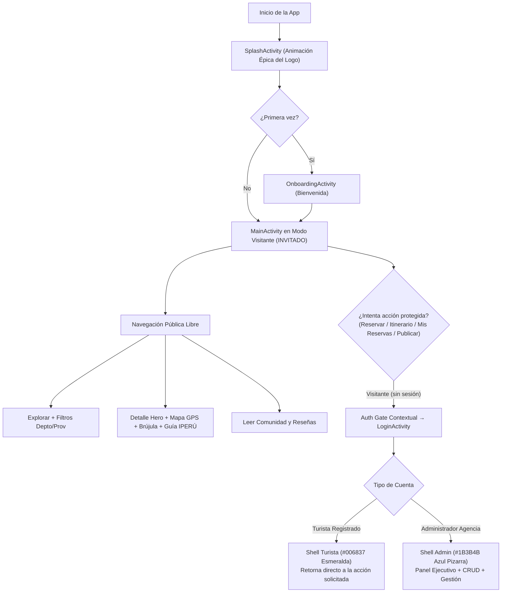

# Roadmap de Cierre, Checklist por Fases y Módulo Administrador — `PerúViajero`

Este documento centraliza el **plan incremental por fases** (con 1 commit por fase) para completar:
1. Cumplimiento técnico de **Semana 13** (Permisos UX + `ContentResolver`) y **Semana 14** (Notificaciones Push JSON, Canales, Agrupación, `TaskStackBuilder` y Bandeja de Avisos).
2. Rediseño visual del flujo **Cotizar → Pagar → Boleto Oficial** basado en los mockups aprobados ([07](../mockups_ux_ui/07_cotizar_reservar_tour.jpg), [08](../mockups_ux_ui/08_pasarela_pagos_segura.jpg), [09](../mockups_ux_ui/09_ver_boleto_voucher.jpg)).
3. **Módulo completo de Administrador** con identidad visual diferenciada, control de roles (`INVITADO` / `TURISTA` / `ADMIN`), gestión de reservas por destino y CRUD de lugares turísticos.

---

## 1. Arquitectura de Entrada, Flujos UX y Control de Roles (RBAC)

### 1.1 Flujo de Inicio: Splash Épico → Visitante Público → Auth Gate Contextual (*Lazy Auth*)

Para maximizar la retención (principio UX *Try Before You Sign Up*), la app **nunca bloquea al usuario con un login obligatorio al abrir**. Entra siempre como **Visitante (`INVITADO`)** tras la animación de entrada, y solicita iniciar sesión únicamente en contexto cuando intenta realizar acciones transaccionales o personalizadas:

### 1.2 Paleta Visual Diferenciada por Rol

| Aspecto | Visitante (`INVITADO`) | Turista Registrado (`CLIENTE`) | Administrador (`ADMIN`) |
| :--- | :--- | :--- | :--- |
| **Paleta Principal** | Verde Esmeralda (`#006837` / `#004D25`) | Verde Esmeralda (`#006837` / `#004D25`) | **Azul Pizarra Ejecutivo (*Andean Slate*, `#1B3B4B` / `#102835`)** con acentos `#006837` y `#C1272D` |
| **Badge en Drawer Header** | `VISITANTE` (con botón rápido `"Iniciar Sesión"`) | `TURISTA` | `ADMIN AGENCIA` |
| **Barra Inferior (5 Tabs)** | `Explorar`, `Comunidad`, `Reservas` (muestra estado invitado + CTA login), `Itinerario` (preview + CTA login), `Favoritos` | `Explorar`, `Comunidad`, `Mis Reservas` (central), `Itinerario`, `Favoritos` | **Panel Admin** (central `#1B3B4B`), `Reservas x Destino`, `Catálogo CRUD`, `Comunidad (Moderar)`, `Avisos/Push` |

### 1.3 Matriz Completa de Accesos por Pantalla y Acción

| Pantalla / Acción | Visitante (`INVITADO`) | Turista (`CLIENTE`) | Administrador (`ADMIN`) |
| :--- | :---: | :---: | :---: |
| **Splash Animado + Onboarding** | ✅ Acceso total | ✅ Acceso total | ✅ Acceso total |
| **Explorar + Buscador + Filtros (Cat / Depto / Prov)** | ✅ Libre | ✅ Libre | ✅ Libre (vista previa catálogo) |
| **Detalle Hero + Mapa GPS + Brújula + Guía IPERÚ** | ✅ Libre | ✅ Libre | ✅ Libre |
| **Comunidad — Ver reseñas y filtrar** | ✅ Libre | ✅ Libre | ✅ Libre |
| **Comunidad — Publicar foto / Comentar / Like** | 🔒 Pide Login | ✅ Permitido | ✅ Permitido + **Moderar/Eliminar** |
| **Favoritos — Guardar y consultar** | ✅ Local *(sugiere login para respaldo)* | ✅ Permitido | ✅ Permitido |
| **Cotizar y Reservar Tour + Pasarela de Pago** | 🔒 Pide Login | ✅ Permitido | 👁️ Solo consulta / gestión |
| **Mis Reservas / Ver Boleto QR** | 🔒 Pantalla CTA *"Inicia sesión para ver tus boletos"* | ✅ Sus reservas | ✅ **Todas las reservas** (filtro por Destino/Estado) |
| **Itinerario Personal (Crear / Completar / Sugerencias)** | 🔒 Preview bloqueado + CTA Login | ✅ Permitido | ✅ Permitido |
| **Bandeja de Avisos Turísticos (`🔔`)** | ✅ Alertas públicas | ✅ Alertas + sus reservas | ✅ **Emitir nuevas alertas Push** |
| **Dashboard KPIs + Datos Fiscales MINCETUR** | ❌ Oculto | ❌ Oculto | ✅ Acceso exclusivo |
| **CRUD de Lugares Turísticos (Crear / Editar / Ocultar)** | ❌ Oculto | ❌ Oculto | ✅ Acceso exclusivo |

---

## 2. Funcionalidades del Módulo Administrador

### A. Dashboard Ejecutivo de Agencia
- **KPIs en vivo:** Total de reservas, ingresos acumulados (`S/.`), total de pasajeros movilizados y destino más reservado (*Tour Top*).
- **Datos Fiscales (MINCETUR):** Edición de Razón Social, RUC, Registro MINCETUR, dirección y teléfono, reflejados automáticamente en todos los boletos/vouchers emitidos.
- **Accesos rápidos Admin:** *Nuevo Lugar Turístico*, *Filtrar Reservas*, *Emitir Alerta Push*, *Exportar/Ver Resumen*.

### B. Gestión Avanzada de Reservas (por Destino y Estado)
- **Filtros combinados:**
  - Selector de **Destino** (`Todos`, `Machu Picchu`, `Cañón del Colca`, `Huacachina`, etc.).
  - Chips de **Estado** (`Todas`, `Confirmada`, `En Ruta`, `Completada`, `Cancelada`).
  - Buscador rápido por **código de voucher** (`PV-2026-...`) o **nombre del cliente**.
- **Acciones por reserva:**
  - Cambiar estado del tour (con notificación automática al turista en el canal `Reservas`).
  - Ver **Boleto Oficial** y **Manifiesto de Pasajeros SUTRAN** completo.
  - Abrir ruta GPS / terminal de embarque.

### C. Gestión de Lugares Turísticos (CRUD de Catálogo)
- **Crear lugar turístico:** Formulario con nombre, departamento, provincia, categoría (`Arqueología`, `Naturaleza`, `Aventura`, `Cultura`, `Playa`), descripción, precio base sugerido, coordenadas GPS (latitud/longitud) y fotografía (galería o URL).
- **Editar y eliminar/desactivar:** Modificar datos de destinos creados por la agencia o activar/ocultar atractivos del catálogo.
- **Persistencia sin hardcodeo:** Guardado en `DestinoService` / almacenamiento local combinado con la API REST para que el nuevo destino aparezca de inmediato en `Explorar` y en los filtros de **Departamento y Provincia**.

### D. Moderación Social y Emisión de Alertas Push
- **Moderación en Comunidad:** Opción exclusiva de `ADMIN` para eliminar reseñas inapropiadas o spam.
- **Emisor de Alertas Turísticas (conexión con Semana 14):** Permite al administrador redactar y enviar una alerta por tipo (`alerta`, `reserva`, `itinerario`, `aviso`) con URL opcional, que llega como notificación agrupada y aparece en la **Bandeja de Avisos** del turista.

---

## 3. Checklist Maestro por Fases (1 Commit por Fase)

### Estado Previo Completado
- [x] **Fases A–I:** Shell curvo de 5 pestañas, Drawer envolvente a la cámara, `Explorar` (con filtros por Departamento y Provincia), `Comunidad`, `Mis Reservas` (*Boarding Pass*), `Itinerario`, `Favoritos` (`Sierra`/`Costa`/`Selva`), `Detalle Hero`, capa `services/*.json` y auditoría global de paleta (`Light` & `Dark`).

---

### Fase J — Semana 13: Permisos UX (4 Estados) + `ContentResolver` de Contactos
- [x] **Crear `GestorPermisos.kt` reutilizable:** `enum Estado` (`CONCEDIDO`, `PENDIENTE`, `DENEGADO`, `BLOQUEADO`), persistencia de "ya preguntado" en `SharedPreferences`, diálogos educativos (*rationale*) y redirección a `Settings.ACTION_APPLICATION_DETAILS_SETTINGS`.
- [x] **Permisos en contexto:** Retirar solicitud automática de `POST_NOTIFICATIONS` al iniciar `MainActivity` y pedirlo únicamente al reservar, programar recordatorios o activar avisos.
- [x] **Importar acompañantes en `ReservaTourActivity` (`READ_CONTACTS` + `ContentResolver`):**
  - Declarar `READ_CONTACTS` en `AndroidManifest.xml`.
  - Consultar `ContactsContract.CommonDataKinds.Phone.CONTENT_URI` con `.use { cursor -> ... }` y `try/catch (SecurityException)`.
  - Evitar duplicados (`ContactoImportHelper`) y mantener **degradación elegante** (si el usuario deniega o bloquea, sigue registrando pasajeros manualmente con estado visible en pantalla).
- [x] **Verificación + Commit Fase J** (`testDebugUnitTest assembleDebug` + `ContactoImportHelperTest` 2/2).

---

### Fase K — Semana 14: Bandeja de Avisos, Payload JSON, Canales, Agrupación y `TaskStackBuilder`
- [x] **Capa de datos y parseo seguro (`assets/services/avisos.json` + `AvisoService` + `AvisoRepository` + `AvisoPayloadParser`):**
  - Persistencia de los últimos 50 avisos con estado `leído / no leído` y filtro por tipo.
  - Parseo seguro de JSON (`titulo`/`cuerpo` obligatorios, `tipo`/`region`/`url` opcionales, captura de errores de formato y validación estricta de `url` `http/https`).
- [x] **4 canales por prioridad y agrupación en `NotificationHelper.kt`:**
  - Canales diferenciados: `alerta` (`HIGH`), `reserva` (`HIGH`), `itinerario` (`DEFAULT`), `aviso` (`LOW`) con colores por tipo.
  - Agrupación real: `.setGroup(...)` + resumen `.setGroupSummary(true)` con `InboxStyle` y `GROUP_ALERT_CHILDREN` (≥ 2 no leídos).
  - `PendingIntent` con `TaskStackBuilder` pasando solo `EXTRA_AVISO_ID` hacia `DetalleAvisoActivity` (con `parentActivityName`).
  - Acción rápida `"Marcar leído"` directo desde la notificación.
- [x] **Simulador + FCM unificados:** `AvisoPushReceiver` (`BroadcastReceiver`) + `AvisoPushSimulator` (`AlarmManager.setAndAllowWhileIdle`) compartiendo lógica con `PeruViajeroMessagingService`.
- [x] **Pantallas `BandejaAvisosActivity` (campana `🔔`) y `DetalleAvisoActivity`:**
  - Contador de no leídos, chips de filtro por tipo, botón *"Marcar leídos"*, simulador JSON para pruebas y control de `aviso == null` + botón *"Abrir enlace oficial"* cuando exista `url`.
- [x] **Tests unitarios JVM + Commit Fase K** (`AvisoPayloadParserTest` 4/4 + `testDebugUnitTest assembleDebug`).

---

### Fase L — Rediseño UX/UI del Flujo de Reserva, Pago y Boleto Oficial *(fiel 1:1 a los mockups)*
- [x] **Cotizar y Reservar Tour ([07_cotizar_reservar_tour.jpg](../mockups_ux_ui/07_cotizar_reservar_tour.jpg)):** Replicar tal cual el diseño aprobado: tarjeta resumen del destino con badge `S/ 150 / pers`, tarjeta `Fecha y Embarque`, tarjeta `Pasajeros (Manifiesto SUTRAN)` con stepper verde + botones `Importar Contactos` y `Registrar DNI`, chips de `Personaliza tu Experiencia` (Movilidad y Guía Oficial) y barra sticky inferior (`Total Inc. IGV` + `Continuar al Pago`).
- [x] **Pasarela de Pagos Segura ([08_pasarela_pagos_segura.jpg](../mockups_ux_ui/08_pasarela_pagos_segura.jpg)):** Replicar tal cual el diseño aprobado: encabezado SSL 256-bit, resumen esmeralda con desglose de IGV, pestañas `Tarjeta` / `Yape / Plin` / `Código CIP`, tarjeta virtual en degradado esmeralda, campos redondeados, badges de confianza y botón píldora `Pagar S/ ... Ahora`.
- [x] **Ver Boleto / Voucher Oficial ([09_ver_boleto_voucher.jpg](../mockups_ux_ui/09_ver_boleto_voucher.jpg)):** Replicar tal cual el diseño aprobado: boleto vertical perforado con muescas laterales y línea punteada, cabecera fiscal `MINCETUR` + badge `CONFIRMADA`, miniatura + código `PV-...`, grilla 2 columnas (`Embarque`, `Transporte`, `Guía Oficial`, `Pasajeros`), caja `Manifiesto de Pasajeros`, código QR escaneable (`QrVisualView`), `Total Pagado` y botones inferiores `Ver en Mapa` / `Compartir Boleto`.
- [x] **Verificación + Commit Fase L** (`testDebugUnitTest assembleDebug`).

---

### Fase M — Módulo Administrador Completo, Control de Roles y Paleta Ejecutiva Admin
- [x] **Paleta diferenciada de Administrador (`#1B3B4B` / `#102835`):** Cambio dinámico de color en Toolbar, cabecera del Drawer (`DrawerHeaderBgView.setPalette`), botón central y chips activos al activar `RolUsuario.ADMIN` (manteniendo Light & Dark mode).
- [x] **Control estricto de roles (RBAC):** Separación de vistas y pestañas entre Visitante/Turista (`Mis Reservas` / `Itinerario`) y Administrador (`Agencia` / `Catálogo CRUD`) en `MainActivity`, menú lateral y fragments.
- [x] **Gestión de Reservas por Destino y Estado:** Filtro por destino, chips de estado (`Todas`, `Confirmada`, `En Ruta`, `Completada`, `Cancelada`), buscador por voucher/cliente (`AdminFilterHelper`), 4 KPIs (incluyendo Viajeros) y cambio de estado con notificación automática.
- [x] **CRUD de Lugares Turísticos (`AdminCatalogoFragment` + `DestinoService`):** Alta, edición y activación/desactivación de atractivos turísticos persistidos localmente y fusionados en vivo con el catálogo de `Explorar`.
- [x] **Moderación de Comunidad + Emisor de Alertas Push Admin:** Eliminación de reseñas (solo `ADMIN` en `PublicacionAdapter`/`ComunidadFragment`) y envío directo de alertas a la Bandeja de Avisos.
- [x] **Tests unitarios JVM + Commit Fase M** (`AdminFilterHelperTest` 2/2 + `testDebugUnitTest assembleDebug`).

---

### Fase N — Nuevo Logo Oficial + Splash Épico Animado + Modo Visitante Público + Auth Gate Contextual
- [x] **Aplicar Nuevo Logo Oficial de la App ([logo_app_icon_propuesta.jpg](../mockups_ux_ui/logo_app_icon_propuesta.jpg)):**
  - Reemplazar ícono adaptable de Android (`ic_launcher_foreground.xml`, `ic_launcher_background.xml`) con el emblema oficial aprobado (Pin GPS blanco + montañas gemelas de Machu Picchu + camino + sol dorado `#FFB300` + punta carmesí `#C1272D` sobre degradado esmeralda `#006837` → `#004D25`).
  - Actualizar `ic_logo_peruviajero_agency.xml` para que el nuevo logo aparezca también en Login, Pasarela de Pagos, Panel Admin y Splash Screen.
- [x] **`SplashActivity.kt` (Launcher con animación de entrada épica):**
  - Fondo degradado esmeralda profundo (`#004D25` → `#006837`) con ondas/resplandor sutil.
  - Animación coreografiada (`AnimatorSet` + `OvershootInterpolator`): entrada elástica del nuevo logo oficial centrado, pulso de halo luminoso, aparición deslizante del título `"PerúViajero"` + subtítulo `"Descubre el Perú a tu ritmo"` y transición *cross-fade* fluida (~1.8 s) hacia `OnboardingActivity` (primera vez) o `MainActivity` en modo **Visitante**.
- [x] **Modo Visitante (`INVITADO`) por defecto al iniciar:**
  - Garantizar navegación libre sin login en `Explorar`, `Detalle Hero`, `Mapa GPS`, `Brújula`, `Guía IPERÚ` y lectura de `Comunidad`.
  - Mostrar badge `VISITANTE` y botón directo `"Iniciar Sesión"` en el Drawer Header.
- [x] **Auth Gate Contextual (`AuthGuardHelper.kt`):**
  - Helper centralizado que intercepta acciones protegidas (`Reservar`, `Itinerario`, `Mis Reservas`, `Publicar/Comentar` en Comunidad) cuando `!sessionRepo.isLoggedIn()`.
  - Abre un modal/diálogo elegante hacia `LoginActivity` explicando el motivo y permitiendo ingresar como **Turista Registrado** o **Administrador**.
  - En `Mis Reservas` para Visitante: vista vacía atractiva con botón `"Iniciar Sesión / Registrarme"`; en `Itinerario`: preview de solo lectura con protección contextual al editar/añadir.
- [x] **`OnboardingActivity.kt` (Bienvenida Épica garantizada en primer inicio):**
  - Versión `key_first_run_v2` en `PreferencesHelper` para asegurar que la bienvenida aparezca al iniciar la app por primera vez tras instalar/actualizar (y repetible desde el menú lateral).
  - Degradados inmersivos full-screen con *morphing* en vivo (`ArgbEvaluator`), `PageTransformer` con parallax 3D, medallón central flotante con anillos orbitales, pills glassmórficos y CTA final hacia **Modo Visitante** o **Iniciar Sesión**.
- [x] **Verificación + Build Release R8 + Commit Fase N** (`testDebugUnitTest assembleDebug assembleRelease` — 27/27 tests JVM + R8 + lintVital + checklist movido a `docs/checklists_terminados/`).
