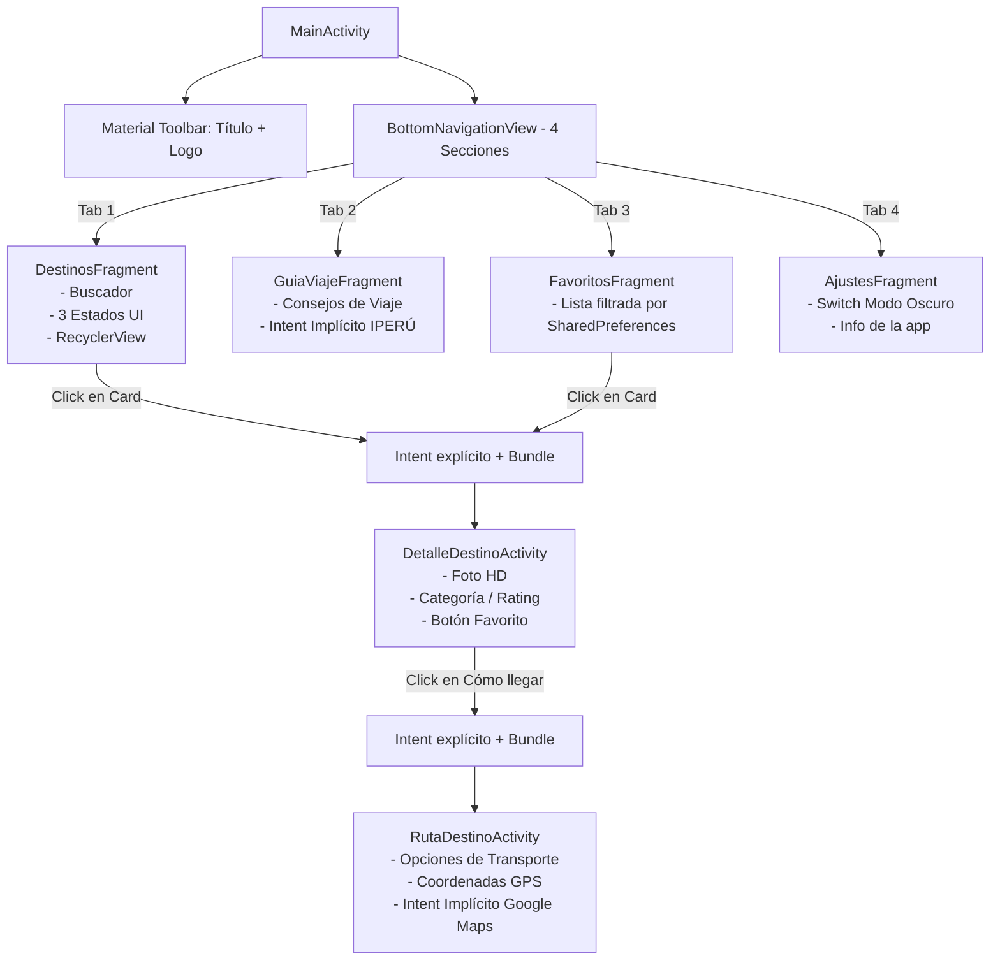
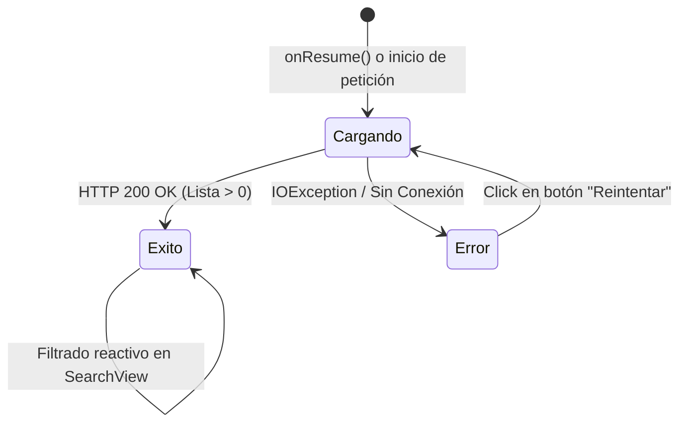

# Especificación de Arquitectura y Componentes de UI (SDD-UI)
**Proyecto:** PerúViajero  
**Documento:** `planeamiento/03_especificacion_arquitectura_ui.md`  
**Estado:** Validado  

---

## 1. Arquitectura de Navegación y Pantallas



---

## 2. Máquina de Estados de Carga de Red (Requisito de Rúbrica - 20%)

En `DestinosFragment`, la interfaz responde a tres estados mutuamente excluyentes:



| Estado | Elemento Visual Activo | Visibilidad |
| :--- | :--- | :--- |
| **1. CARGANDO** | `ProgressBar` | `View.VISIBLE` |
| | `RecyclerView` | `View.GONE` |
| | `Layout Error` (`LinearLayout`) | `View.GONE` |
| **2. ÉXITO** | `ProgressBar` | `View.GONE` |
| | `RecyclerView` | `View.VISIBLE` |
| | `Layout Error` | `View.GONE` |
| **3. ERROR** | `ProgressBar` | `View.GONE` |
| | `RecyclerView` | `View.GONE` |
| | `Layout Error` (Ícono Wifi-Off + Texto + Botón "Reintentar") | `View.VISIBLE` |

---

## 3. Especificación del Estado Dinámico (Equivalente `useState` / React Native)

Para cumplir el criterio del **20% en estado dinámico**:
1. En `fragment_destinos.xml` se ubica un `com.google.android.material.textfield.TextInputLayout` o `androidx.appcompat.widget.SearchView`.
2. Se registra un listener de texto en tiempo real (`TextWatcher` / `setOnQueryTextListener`).
3. En cada tipeo, se invoca `destinoAdapter.filter(texto)` que:
   - Filtra la lista en memoria sin recrear la Activity.
   - Llama a `notifyDataSetChanged()`.
   - Si no hay coincidencias, muestra una vista de *"No se encontraron destinos"*.

---

## 4. Especificación del Sistema de Temas (DayNight)

* **Tema Base:** `Theme.MaterialComponents.DayNight.NoActionBar`
* **Colores Tema Claro (`res/values/colors.xml`):**
  - Primary: `#006837` (Verde Perú)
  - Secondary: `#C1272D` (Rojo Inti)
  - Background: `#F8F9FA`
  - Surface: `#FFFFFF`
  - Text: `#212529`
* **Colores Tema Oscuro (`res/values-night/colors.xml`):**
  - Primary: `#48C774`
  - Secondary: `#FF3860`
  - Background: `#121212`
  - Surface: `#1E1E1E`
  - Text: `#F5F5F5`
* **Aplicación programática:**
  ```java
  if (PreferencesHelper.getInstance(this).isDarkMode()) {
      AppCompatDelegate.setDefaultNightMode(AppCompatDelegate.MODE_NIGHT_YES);
  } else {
      AppCompatDelegate.setDefaultNightMode(AppCompatDelegate.MODE_NIGHT_NO);
  }
  ```

