# Plan de Desarrollo SDD y Matriz de Tareas (SDD-PLAN)
**Proyecto:** PerúViajero  
**Documento:** `planeamiento/04_plan_desarrollo_sdd_tareas.md`  
**Estado:** Listo para Ejecución  

---

## 1. Fases del Plan de Construcción

```mermaid
gantt
    title Plan de Desarrollo SDD - PerúViajero
    dateFormat  X
    axisFormat %s
    section Sprint 1
    Configuración Gradle y Recursos       :s1, 0, 1
    section Sprint 2
    Modelos, Retrofit y Capa de Red      :s2, 1, 2
    section Sprint 3
    Vistas, Adaptador y 3 Estados UI     :s3, 2, 3
    section Sprint 4
    Filtro Reactivo, Favoritos y Temas   :s4, 3, 4
    section Validación
    Pruebas Offline, Capturas y Sustento :v1, 4, 5
```

---

## 2. Desglose de Tareas con Criterios de Aceptación (*Definition of Done*)

### Sprint 1: Setup Estructural, Recursos y Layouts Base
* **Tarea 1.1:** Configurar dependencias en `app/build.gradle` (Retrofit, Gson, Glide, Material Components, Navigation).
* **Tarea 1.2:** Crear recursos XML en `res/values` y `res/values-night` (Colores, Temas, Strings en español).
* **Tarea 1.3:** Crear layouts de pantalla:
  - `activity_main.xml` (Toolbar + FragmentContainerView + BottomNavigationView).
  - `fragment_destinos.xml` (Layout con buscador, ProgressBar, RecyclerView y contenedor de error).
  - `item_destino.xml` (CardView con imagen, título, departamento, rating y botón de favorito).
  - `activity_detalle_destino.xml` (Imagen expandida, categoría, descripción y botón volver).
  - `fragment_favoritos.xml` y `fragment_ajustes.xml`.
* **Criterio de Aceptación (DoD):** El proyecto compila sin errores de recursos y los layouts se renderizan limpiamente en el visor de diseño.

---

### Sprint 2: Modelos, Contrato de Datos y Capa de Red
* **Tarea 2.1:** Implementar `pe.edu.utp.peruviajero.data.model.Destino.java` con anotaciones `@SerializedName` y getters/setters.
* **Tarea 2.2:** Implementar `pe.edu.utp.peruviajero.network.ApiClient.java` configurando Retrofit con timeout y Gson.
* **Tarea 2.3:** Implementar `pe.edu.utp.peruviajero.network.TourismApiService.java` con el endpoint `@GET`.
* **Criterio de Aceptación (DoD):** Una prueba de conexión obtiene la lista de 12 destinos deserializados en objetos `Destino` con éxito.

---

### Sprint 3: Adaptador, Vistas y los 3 Estados de Interfaz
* **Tarea 3.1:** Implementar `pe.edu.utp.peruviajero.adapter.DestinoAdapter.java` gestionando el inflado de tarjetas y enlace de datos.
* **Tarea 3.2:** Integrar **Glide** en el `ViewHolder` para carga asíncrona de imágenes con placeholders.
* **Tarea 3.3:** Implementar la lógica de los 3 estados en `DestinosFragment.java`:
  - `mostrarCargando()`: `progressBar.setVisibility(View.VISIBLE)`.
  - `mostrarExito(List<Destino>)`: lista visible y actualización del adaptador.
  - `mostrarError(String mensaje)`: vista de error visible y enlace del listener en el botón *"Reintentar"*.
* **Tarea 3.4:** Conectar el clic de la tarjeta para lanzar `DetalleDestinoActivity` vía `Intent`.
* **Criterio de Aceptación (DoD):** Al apagar la red en el emulador se muestra la pantalla de error y al pulsar "Reintentar" con red vuelve a cargar la lista.

---

### Sprint 4: Estado Dinámico, SharedPreferences y Tema Visual
* **Tarea 4.1:** Implementar el método `filter(String query)` en el adaptador para búsqueda reactiva en tiempo real.
* **Tarea 4.2:** Desarrollar `pe.edu.utp.peruviajero.data.local.PreferencesHelper.java` con métodos:
  - `setFavorito(String id, boolean esFavorito)`
  - `isFavorito(String id)`
  - `getFavoritosIds()`
  - `setDarkMode(boolean enabled)`
  - `isDarkMode()`
* **Tarea 4.3:** Vincular el botón de estrella/corazón de la tarjeta con `PreferencesHelper` para actualizar el estado instantáneamente.
* **Tarea 4.4:** En `AjustesFragment`, conectar el Switch con `AppCompatDelegate.setDefaultNightMode()` y guardar la preferencia.
* **Criterio de Aceptación (DoD):** Al cerrar la aplicación y volver a abrirla, los favoritos y el tema visual seleccionado permanecen intactos.

---

### Sprint 5: Verificación, Capturas de Sustentación y Entrega
* **Tarea 5.1:** Tomar y verificar las 4 capturas obligatorias exigidas por la rúbrica:
  1. Lista con datos reales cargados.
  2. Estado de carga (`ProgressBar`).
  3. Estado de error (simulado sin internet).
  4. Estado dinámico (buscador activo).
* **Tarea 5.2:** Validar el `README.md` principal del proyecto con los endpoints finales y respuestas para la sustentación.

