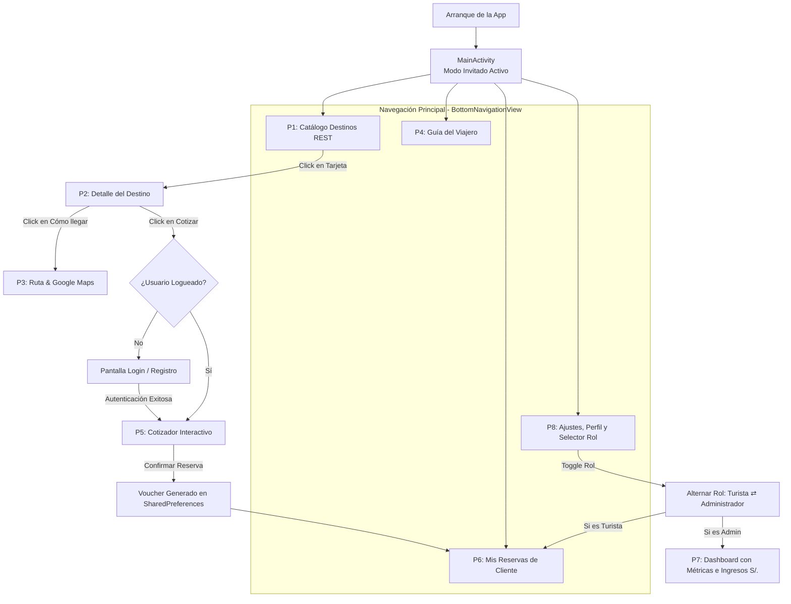

# Catálogo de Pantallas, Roles y Plan de Implementación (SDD-SCREENS)
**Proyecto:** PerúViajero Tours & Travel S.A.C.  
**Documento:** `planeamiento/06_catalogo_pantallas_y_roles.md`  
**Tipo:** Especificación de Pantallas y Navegación (Solo Markdown)  
**Estado:** Planeamiento Formal Aprobado  

---

## 1. Resumen Cuantitativo de Pantallas del Sistema

El aplicativo consta de un total de **8 pantallas y vistas estructuradas** entre `Activities`, `Fragments` y componentes de navegación:

| # | Nombre de Pantalla / Componente | Tipo de Componente | Rol de Acceso | Propósito Principal |
| :-: | :--- | :--- | :--- | :--- |
| **P1** | **Catálogo de Destinos** (`DestinosFragment`) | `Fragment` | Invitado / Turista / Admin | Exploración de 12 tours vía API REST, 3 estados de red y buscador en vivo. |
| **P2** | **Detalle del Destino** (`DetalleDestinoActivity`) | `Activity` | Invitado / Turista / Admin | Ficha completa del tour, precio base por persona y acceso a cotización o rutas. |
| **P3** | **Ruta y ¿Cómo llegar?** (`RutaDestinoActivity`) | `Activity` | Invitado / Turista / Admin | Coordenadas GPS, opciones de transporte e Intent implícito a Google Maps. |
| **P4** | **Guía del Viajero** (`GuiaViajeFragment`) | `Fragment` | Invitado / Turista / Admin | Consejos de viaje (soroche, moneda) e Intent implícito telefónico a IPERÚ. |
| **P5** | **Cotizador Interactivo de Tours** (`ReservaTourActivity`) | `Activity` | **Turista / Cliente** | Configuración de fecha, pasajeros, movilidad, hotel y cálculo dinámico de total. |
| **P6** | **Mis Reservas** (`MisReservasFragment`) | `Fragment` | **Turista / Cliente** | Visualización de vouchers contratados y estados de viaje persistidos. |
| **P7** | **Panel de Control / Dashboard** (`AdminDashboardFragment`) | `Fragment` | **Administrador / Agente** | Métricas de ventas en S/., total de reservas globales y cambio de estados. |
| **P8** | **Perfil, Ajustes y Roles** (`AjustesFragment` / `LoginActivity`) | `Fragment / Activity` | Invitado / Turista / Admin | Switch de Modo Oscuro, inicio de sesión y conmutador rápido de rol. |

---

## 2. Clasificación de Pantallas por Roles de Usuario

```
                                      ACCESO AL SISTEMA
                                              │
         ┌────────────────────────────────────┼────────────────────────────────────┐
         ▼                                    ▼                                    ▼
  MODO INVITADO (GUEST)             ROL 1: TURISTA (CLIENTE)             ROL 2: ADMIN (AGENCIA)
  • P1: Catálogo REST               • P1: Catálogo REST                  • P1: Catálogo REST
  • P2: Detalle de Destino          • P2: Detalle de Destino             • P2: Detalle de Destino
  • P3: Ruta & Google Maps          • P3: Ruta & Google Maps             • P3: Ruta & Google Maps
  • P4: Guía Perú & IPERÚ           • P4: Guía Perú & IPERÚ              • P4: Guía Perú & IPERÚ
  • P8: Ajustes (Invita a login)    • P5: Cotizador y Reserva (PRO)      • P7: Panel Admin & Métricas (PRO)
                                    • P6: Mis Reservas & Vouchers        • P8: Ajustes (Modo Admin activo)
                                    • P8: Perfil Turista & Tema
```

---

## 3. Especificación Técnica Pantalla por Pantalla

---

### 📱 Pantalla 1: Catálogo de Destinos (`DestinosFragment`)
* **Acceso:** Público (Invitado, Turista, Administrador).
* **Navegación:** Pestaña 1 del `BottomNavigationView` en `MainActivity`.
* **Componentes Visuales:**
  - `TextInputLayout` con `TextInputEditText` para el buscador en tiempo real.
  - `FrameLayout` contenedor con gestión de los **3 estados de carga**:
    1. `layoutCargando`: `ProgressBar` centrado con mensaje de espera.
    2. `rvDestinos`: `RecyclerView` con tarjetas `CardView` (`item_destino.xml`).
    3. `layoutError`: Ícono de desconexión, mensaje de error y botón `btnReintentar`.
* **Interacción Dinámica (useState eq.):**
  - `TextWatcher` en el buscador que invoca `destinoAdapter.filter(texto)` filtrando la lista en memoria al instante sin recrear la Activity.
* **Capa de Datos:** Petición asíncrona `GET` mediante **Retrofit 2** hacia `TourismApiService.getDestinos()`. Carga de imágenes con **Glide**.
* **Transición:** Al tocar cualquier tarjeta, lanza `DetalleDestinoActivity` vía `Intent` explícito con el objeto `Destino` serializado en el `Bundle`.

---

### 📱 Pantalla 2: Detalle del Destino Turístico (`DetalleDestinoActivity`)
* **Acceso:** Público (Invitado, Turista, Administrador).
* **Navegación:** Desde el clic de cualquier tarjeta de `DestinosFragment`.
* **Componentes Visuales:**
  - `MaterialToolbar` con botón de retroceso hacia `MainActivity`.
  - `ImageView` principal con fotografía en alta resolución.
  - Ficha técnica: Nombre, departamento, insignia de categoría, calificación con estrellas y descripción completa.
  - Tarjeta de tarifa comercial: Precio base por persona (ej. S/ 120.00).
  - Dos botones de acción principales:
    1. `btnComoLlegar`: Botón outlined *"¿Cómo llegar y Ubicación?"*.
    2. `btnReservarTour`: Botón primario *"Cotizar y Reservar Tour"*.
* **Lógica de Roles y Seguridad:**
  - Si el usuario pulsa `btnReservarTour`:
    - Si está autenticado como **Turista**: abre de inmediato la Pantalla 5 (`ReservaTourActivity`).
    - Si está en **Modo Invitado**: despliega un diálogo o pantalla de `LoginActivity` solicitando registrarse o iniciar sesión antes de reservar.
* **Transición:**
  - `btnComoLlegar` ➔ Abre Pantalla 3 (`RutaDestinoActivity`).
  - `btnReservarTour` ➔ Abre Pantalla 5 (`ReservaTourActivity`) o Pantalla 8 (`LoginActivity`).

---

### 📱 Pantalla 3: Ruta y ¿Cómo llegar? (`RutaDestinoActivity`)
* **Acceso:** Público (Invitado, Turista, Administrador).
* **Navegación:** Desde `DetalleDestinoActivity`.
* **Componentes Visuales:**
  - `MaterialToolbar` con botón volver.
  - Tarjeta con coordenadas geográficas del atractivo (`latitud`, `longitud`).
  - Tarjetas informativas de transporte contextualizadas por región:
    - ✈️ Vía Aérea (Aeropuertos y tiempos de vuelo).
    - 🚌 Vía Terrestre (Rutas nacionales y horas de viaje en bus).
    - 🥾 Acceso Local (Trenes a Machu Picchu, lanchas en Iquitos, tubulares en Huacachina o caminata).
  - Botón de acción `btnAbrirGoogleMaps`: *"Abrir en Google Maps / GPS"*.
* **Intent Implícito (Rúbrica UTP):**
  - Ejecuta un `Intent(Intent.ACTION_VIEW, Uri.parse("geo:lat,lng?q=..."))` hacia la app nativa de mapas del dispositivo.

---

### 📱 Pantalla 4: Guía del Viajero (`GuiaViajeFragment`)
* **Acceso:** Público (Invitado, Turista, Administrador).
* **Navegación:** Pestaña fija en el `BottomNavigationView`.
* **Componentes Visuales:**
  - Consejos de Aclimatación y prevención del Soroche (mal de altura en Cusco/Puno).
  - Información de Temporadas de Viaje (temporada seca vs lluvias en sierra y selva).
  - Moneda oficial (PEN), métodos de pago recomendados (efectivo vs digital).
  - Tarjeta de Asistencia al Turista con botón `btnLlamarIperu`: *"Llamar a IPERÚ (01 574-8000)"*.
* **Intent Implícito (Rúbrica UTP):**
  - Ejecuta un `Intent(Intent.ACTION_DIAL, Uri.parse("tel:015748000"))` para abrir el marcador telefónico del teléfono.

---

### 📱 Pantalla 5: Cotizador Interactivo de Tours (`ReservaTourActivity`) [ROL: TURISTA]
* **Acceso:** Exclusivo para clientes autenticados (o tras loguearse desde Invitado).
* **Navegación:** Invocada desde el botón *"Cotizar y Reservar Tour"* de la Pantalla 2.
* **Componentes Visuales de Alta Interacción:**
  1. **Selector de Fecha:** Campo interactivo con ícono de calendario que despliega un `DatePickerDialog` nativo de Android.
  2. **Contador Reactivo de Pasajeros:**
     - Botón `[ - ]` decrementa (mínimo 1 pasajero).
     - `TextView` central con número de viajeros.
     - Botón `[ + ]` incrementa (máximo 10 pasajeros).
  3. **Selector de Movilidad / Transporte (`RadioGroup` o `ChipGroup`):**
     - Van Turística Estándar (+S/ 0.00 / persona).
     - Bus Panorámico Confort (+S/ 25.00 / persona).
     - Camioneta 4x4 Aventura (+S/ 50.00 / persona).
     - Tren Ejecutivo Primera Clase (+S/ 90.00 / persona).
  4. **Selector de Alojamiento / Hotel (`RadioGroup`):**
     - Solo Tour (Sin Hotel) (+S/ 0.00).
     - Hotel Turista 3 Estrellas (+S/ 45.00 por noche / persona).
     - Hotel Superior 4 Estrellas (+S/ 95.00 por noche / persona).
     - Resort & Spa 5 Estrellas (+S/ 180.00 por noche / persona).
  5. **Visor de Cotización Total en Vivo:**
     - Tarjeta destacada con `TextView` de precio total en Soles (S/.) que se recalcula instantáneamente ante cualquier cambio de fecha, pasajeros, movilidad u hotel.
  6. **Botón de Confirmación:**
     - `btnConfirmarReserva`: Botón Material que genera un código único (ej. `PV-2026-9182`), almacena el objeto en `SharedPreferences` y muestra un diálogo de confirmación de reserva exitosa.
* **Estado Dinámico:** Implementa la lógica reactiva más potente del proyecto, sin recargas de Activity ni parpadeos.

---

### 📱 Pantalla 6: Mis Reservas (`MisReservasFragment`) [ROL: TURISTA]
* **Acceso:** Turista / Cliente autenticado.
* **Navegación:** Pestaña 2 del `BottomNavigationView` para usuarios con rol Turista.
* **Componentes Visuales:**
  - `RecyclerView` (`rvMisReservas`) con tarjetas de vouchers contratados (`item_reserva.xml`).
  - Cada tarjeta de reserva muestra:
    - Código de reserva (ej. `PV-2026-4819`).
    - Destino turístico con su foto en miniatura.
    - Fecha de salida y cantidad de pasajeros.
    - Movilidad y hotel seleccionados.
    - Costo total pagado en Soles (S/.).
    - Badge de estado del tour: `"Confirmada"` (verde/azul).
  - `layoutVacio`: Mensaje con ilustración amigable cuando el usuario aún no tiene reservas creadas.
* **Persistencia:** Recupera la lista de reservas del cliente desde `PreferencesHelper.kt` en formato JSON mediante `Gson`.

---

### 📱 Pantalla 7: Panel de Control / Dashboard (`AdminDashboardFragment`) [ROL: ADMINISTRADOR]
* **Acceso:** Exclusivo para el Administrador / Agente de la Empresa.
* **Navegación:** Reemplaza la pestaña de reservas en el `BottomNavigationView` cuando el rol activo es Administrador.
* **Componentes Visuales:**
  - **Fila de Métricas y KPIs de la Agencia:**
    - Tarjeta 1: 📊 **Total de Reservas** (contador de contrataciones globales).
    - Tarjeta 2: 💰 **Ingresos Totales en S/.** (suma monetaria de todas las reservas registradas).
    - Tarjeta 3: 🏆 **Destino Estrella** (nombre del atractivo más reservado por los clientes).
  - **Gestor de Reservas de Clientes:**
    - `RecyclerView` con todas las reservas registradas por todos los usuarios.
    - Botón en cada tarjeta para **cambiar el estado de viaje del cliente**:
      `"Confirmada"` ➔ `"En Ruta / Pasajeros en Viaje"` ➔ `"Completada"`.
    - Al cambiar el estado, se actualiza en `SharedPreferences` y el cliente ve su voucher actualizado en tiempo real.

---

### 📱 Pantalla 8: Perfil, Ajustes y Selector de Rol (`AjustesFragment` / `LoginActivity`)
* **Acceso:** Público / Adaptativo.
* **Navegación:** Pestaña 4 del `BottomNavigationView`.
* **Componentes Visuales:**
  1. **Tarjeta de Sesión y Perfil del Usuario:**
     - Si está en **Modo Invitado**: Muestra *"Hola, Viajero"* y botón `"Iniciar Sesión / Registrarse"`.
     - Si está logueado como **Turista**: Muestra nombre del cliente, correo y badge `"Rol: Turista"`.
     - Si está logueado como **Administrador**: Muestra *"Agente de Operaciones"*, badge `"Rol: Administrador"` e ícono de empresa.
     - Botón `"Cerrar Sesión"`.
  2. **Conmutador Rápido de Rol (Para Sustentación Académica):**
     - Botón interactivo de 1 solo clic: `[ Cambiar a Modo Administrador ]` ⇄ `[ Cambiar a Modo Turista ]`.
     - Permite que en la sustentación de 2 a 3 minutos el evaluador vea ambos roles sin necesidad de cerrar sesión ni reescribir contraseñas.
  3. **Selector de Tema Visual (Claro / Oscuro):**
     - `SwitchMaterial` conectado a `AppCompatDelegate.setDefaultNightMode()` y guardado en `SharedPreferences`.
  4. **Ficha Académica del Proyecto:**
     - Datos institucionales de la UTP, curso y docentes.

---

## 4. Diagrama de Flujo y Transición entre Pantallas



---

## 5. Plan de Implementación de Pantallas (Roadmap por Fases)

Para cuando decidas dar la orden de codificación, este es el orden estricto de desarrollo para asegurar 0 errores de compilación:

* **Fase 1: Capa de Datos y Persistencia:**
  - Registrar modelos `Usuario.kt` y `Reserva.kt`.
  - Habilitar métodos en `PreferencesHelper.kt` para guardar sesión de usuario y lista de reservas en JSON con Gson.
* **Fase 2: Cotizador Interactivo (Pantalla 5):**
  - Diseñar `activity_reserva_tour.xml` con calendario, contador de pasajeros, radios de transporte y hotel, y visor de precio total en vivo.
  - Implementar lógica de cálculo en `ReservaTourActivity.kt` y vincular botón desde `DetalleDestinoActivity.kt`.
* **Fase 3: Pantalla "Mis Reservas" (Pantalla 6):**
  - Diseñar layout de tarjeta `item_reserva.xml` y adaptador `ReservaAdapter.kt`.
  - Crear `MisReservasFragment.kt` para listar los vouchers contratados.
* **Fase 4: Panel de Administrador y Métricas (Pantalla 7):**
  - Crear `AdminDashboardFragment.kt` con tarjetas de estadísticas (Total reservas, Ingresos acumulados en S/.) y gestor de estados de viaje.
* **Fase 5: Módulo de Autenticación y Navegación Adaptativa (Pantalla 8 y MainActivity):**
  - Crear pantalla de acceso `LoginActivity.kt` con opciones de ingreso rápido por rol.
  - Conectar el conmutador de rol en `AjustesFragment.kt` para que `MainActivity.kt` adapte el `BottomNavigationView` dinámicamente.

