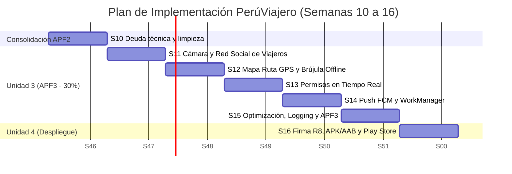

# Plan de Implementación Semana a Semana (Semanas 10 a 16)

**Proyecto:** `PerúViajero` (`pe.edu.utp.perviajero`)  
**Documento maestro:** [README.md](README.md) • **Especificación:** [02_funcionalidades_a_implementar.md](02_funcionalidades_a_implementar.md)

---

## 1. Cronograma Visual (Semanas 10 a 16)

---

## 2. Desglose Detallado por Semana

### Semana 10 — Consolidación APF2 y Corrección de Deuda Técnica
* **Objetivo:** Estabilizar la base de APF2 sin bugs ni inconsistencias antes de implementar hardware y nuevas pantallas.
* **Tareas:**
  * `T10.1`: Agregar fallback a `obtenerDestinosEnCache()` en `FavoritosFragment.kt`.
  * `T10.2`: Restaurar `getLastSearch()` en `DestinosFragment.kt` tras cargar los destinos.
  * `T10.3`: Extraer `VoucherDialogHelper.kt` para eliminar duplicación entre `MisReservasFragment.kt` y `AdminDashboardFragment.kt`.
  * `T10.4`: Actualizar los 2 `ChipGroup.setOnCheckedChangeListener` deprecados en `ItinerarioActivity.kt` a `setOnCheckedStateChangeListener`.
  * `T10.5`: Sincronizar `README.md` raíz (quitar `MockData.kt` y `/v1/destinos`) y corregir enlaces en `planeamiento/README.md`.
* **Criterio de Aceptación (DoD):** `assembleDebug` compila con **0 warnings** en el código propio y Favoritos funciona offline tras una carga previa.

---

### Semana 11 — Cámara del Dispositivo y Red Social "Comunidad de Viajeros"
* **Objetivo:** Integrar la cámara real del dispositivo para que los turistas publiquen experiencias filtradas por **Región** y **Destino** (y actualicen su foto de perfil).
* **Configuración y permisos:**
  * `AndroidManifest.xml`: declarar `<uses-feature android:name="android.hardware.camera" android:required="false" />`, `<uses-permission android:name="android.permission.CAMERA" />` y `<provider>` con `androidx.core.content.FileProvider`.
  * Nuevo `res/xml/file_paths.xml` para guardar fotografías capturadas en `filesDir/Pictures`.
* **Archivos a crear/modificar:**
  * Nuevos modelos: `data/model/PublicacionViajero.kt` (id, autorNombre, autorFotoUri, region, destinoId, destinoNombre, fotoUri, calificacion, comentario, fechaPublicacion, likes, dioLike, comentariosLista) y `ComentarioPublicacion.kt`.
  * `data/local/PreferencesHelper.kt`: persistencia JSON de publicaciones, likes, comentarios, foto de perfil y seed inicial realista por regiones del Perú.
  * Nuevo `adapter/PublicacionAdapter.kt` + `res/layout/item_publicacion.xml`.
  * Nuevas pantallas:
    * `ui/ComunidadActivity.kt` + `res/layout/activity_comunidad.xml` (chips por Región + selector por Destino).
    * `ui/PublicarExperienciaActivity.kt` + `res/layout/activity_publicar_experiencia.xml` (Cámara con `ActivityResultContracts.TakePicture` + galería, región/destino, rating y reseña).
  * Modificaciones: `DestinosFragment.kt` (botón a Comunidad), `DetalleDestinoActivity.kt` (ver reseñas del destino / publicar visita preseleccionando destino y región), `AjustesFragment.kt` (foto de perfil con cámara).
* **Tareas:**
  * `T11.1`: Configurar `FileProvider`, `file_paths.xml` y modelos/persistencia de `PublicacionViajero`.
  * `T11.2`: Construir `ComunidadActivity` con filtros por **Región** y **Destino** + likes/comentarios.
  * `T11.3`: Construir `PublicarExperienciaActivity` capturando foto real con la cámara y conectarlo desde `DetalleDestinoActivity` y `ComunidadActivity`.
  * `T11.4`: Añadir captura de foto de perfil en `AjustesFragment`.
* **Criterio de Aceptación (DoD):** El turista toma una foto real con la cámara (emulador o móvil), la publica vinculada a una región y destino, la ve filtrada en `ComunidadActivity` y desde `DetalleDestinoActivity`, y la publicación persiste tras reiniciar la app.

---

### Semana 12 — Sensores del Dispositivo: Mapa con Ruta GPS y Brújula Offline
* **Objetivo:** Implementar navegación en mapa embebido trazando la ruta desde el GPS real hasta el destino elegido, junto a una brújula física funcional en modo offline.
* **Dependencias y permisos:**
  * `gradle/libs.versions.toml` + `app/build.gradle.kts`:
    * `com.google.android.gms:play-services-location` (GPS de alta precisión).
    * `org.osmdroid:osmdroid-android` (Mapa OpenStreetMap sin API Key de pago y con caché local de tiles).
  * `AndroidManifest.xml`: `ACCESS_FINE_LOCATION`, `ACCESS_COARSE_LOCATION`.
* **Archivos a crear/modificar:**
  * Nuevo `util/LocationHelper.kt`: lectura de ubicación real con `FusedLocationProviderClient`, cálculo de distancia (Haversine) y rumbo (*bearing* en grados hacia destino).
  * Nuevo `network/RoutingService.kt` (Retrofit/OkHttp a `https://router.project-osrm.org/route/v1/driving/...` para obtener puntos de polilínea vial real, con fallback geodésico offline).
  * Nueva pantalla **`ui/MapaRutaActivity.kt`** + `res/layout/activity_mapa_ruta.xml`: mapa embebido OSMDroid con pin de usuario (GPS), pin del destino, polilínea de ruta, distancia en km, tiempo estimado y accesos a Brújula Offline / Google Maps externo.
  * Nueva pantalla **`ui/BrujulaActivity.kt`** + `ui/view/CompassView.kt` + `res/layout/activity_brujula.xml`:
    * Lee `Sensor.TYPE_ACCELEROMETER` + `Sensor.TYPE_MAGNETIC_FIELD` vía `SensorManager` (suavizado con filtro paso-bajo).
    * Muestra Norte magnético, grados, punto cardinal, flecha secundaria de rumbo al destino y panel técnico colapsable de ejes `X, Y, Z`.
    * Funciona 100% sin conexión a internet y desregistra listeners en `onPause()`.
  * Modificaciones: `DetalleDestinoActivity.kt`, `RutaDestinoActivity.kt` y `GuiaViajeFragment.kt` (accesos directos al Mapa GPS y a la Brújula Offline).
* **Tareas:**
  * `T12.1`: Implementar `LocationHelper` y el mapa `MapaRutaActivity` con trazado de ruta (OSRM online + línea directa offline).
  * `T12.2`: Implementar `CompassView` y `BrujulaActivity` con cálculo de Norte magnético + rumbo (*bearing*) al destino escogido.
  * `T12.3`: Integrar entradas desde `DetalleDestinoActivity`, `RutaDestinoActivity` y `GuiaViajeFragment`.
* **Criterio de Aceptación (DoD):** Con coordenadas GPS simuladas en emulador, `MapaRutaActivity` dibuja la ruta hasta el destino y muestra distancia en km; con Modo Avión activado, `BrujulaActivity` rota en vivo y marca el rumbo al destino sin internet.

---

### Semana 13 — Solicitud de Permisos en Tiempo de Ejecución
* **Objetivo:** Centralizar y pulir el flujo de permisos peligrosos en Android (Cámara, Ubicación GPS, Notificaciones) según las guías de Google.
* **Archivos a crear/modificar:**
  * Nuevo `util/PermissionHelper.kt` (`ActivityResultContracts.RequestPermission` / `RequestMultiplePermissions`).
  * Refactorizar `MainActivity.kt` (`POST_NOTIFICATIONS`) e integrar `PermissionHelper` en `PublicarExperienciaActivity`, `MapaRutaActivity`, `BrujulaActivity` (cuando usa GPS para rumbo) y `AjustesFragment`.
* **Tareas:**
  * `T13.1`: Implementar verificación previa y diálogo educativo (*rationale*) antes de solicitar cada permiso.
  * `T13.2`: Implementar manejo de denegación permanente con redirección a *Configuración de la app*.
  * `T13.3`: Agregar sección **"Estado de Permisos"** en `AjustesFragment.kt` (Cámara, Ubicación, Notificaciones).
* **Criterio de Aceptación (DoD):** Si el usuario niega ubicación o cámara una vez, en el segundo intento ve la explicación; si niega permanentemente, puede abrir Ajustes del sistema sin crashes y la app degrada funciones con mensajes claros.

---

### Semana 14 — Notificaciones Locales Programadas y Push (FCM)
* **Objetivo:** Añadir recordatorios automáticos en segundo plano y mensajería push remota.
* **Dependencias:**
  * `androidx.work:work-runtime-ktx` (recordatorios programados persistentes).
  * Firebase BOM + `firebase-messaging-ktx` (con soporte local de pruebas si no hay `google-services.json` en entorno de evaluación).
* **Archivos a crear/modificar:**
  * Nuevo `worker/RecordatorioViajeWorker.kt` (`CoroutineWorker`) que invoca `NotificationHelper`.
  * Actualizar `util/NotificationHelper.kt` con canal de recordatorios y promociones regionales.
  * Nuevo `network/PeruViajeroMessagingService.kt` (`FirebaseMessagingService`) declarado en `AndroidManifest.xml`.
  * Actualizar `ReservaTourActivity.kt` e `ItinerarioActivity.kt` para programar recordatorios al confirmar reserva o actividad.
  * Actualizar `AjustesFragment.kt` con botón *"Simular recordatorio (10s)"* y estado del Token Push FCM.
* **Tareas:**
  * `T14.1`: Implementar `RecordatorioViajeWorker` y enlazarlo a reservas e itinerario.
  * `T14.2`: Integrar `PeruViajeroMessagingService` para recepción en foreground y background.
  * `T14.3`: Validar interacción completa con permiso `POST_NOTIFICATIONS` en Android 13+.
* **Criterio de Aceptación (DoD):** Al programar un recordatorio y cerrar la app, la notificación local aparece y abre la app; las notificaciones push se reciben en primer y segundo plano.

---

### Semana 15 — Rendimiento, Optimización, Errores, Logging y Evaluación `APF3`
* **Objetivo:** Endurecer rendimiento, observabilidad y resiliencia para la evaluación **APF3 (30%)**.
* **Archivos a crear/modificar:**
  * Nuevo `PeruViajeroApp.kt` (`Application` en `AndroidManifest.xml`): inicializa `ApiClient`, `NotificationHelper`, `AppLogger` y `Thread.UncaughtExceptionHandler`.
  * Nuevo `util/AppLogger.kt` (niveles `DEBUG`, `INFO`, `WARN`, `ERROR` + historial persistente).
  * Nuevas pantallas: `ui/DiagnosticoLogsActivity.kt` (accesible desde Ajustes) y `ui/ErrorFatalActivity.kt` (pantalla segura de recuperación).
  * Actualizar `DestinoAdapter.kt`, `ReservaAdapter.kt`, `ActividadItinerarioAdapter.kt` y `PublicacionAdapter.kt` a **`ListAdapter` + `DiffUtil`**.
  * Actualizar `ApiClient.kt` con `Cache` de OkHttp (10 MB) y `HttpLoggingInterceptor` solo en `BuildConfig.DEBUG`.
  * Clasificar excepciones de red en `DestinosFragment.kt` y `MapaRutaActivity.kt`.
  * Implementar pruebas unitarias reales en `app/src/test/java/pe/edu/utp/perviajero/`: `CotizadorTest.kt`, `LocationDistanceTest.kt`, `DestinoFilterTest.kt`, `PublicacionFilterTest.kt`.
* **Tareas:**
  * `T15.1`: Migrar todos los adaptadores a `ListAdapter` + `DiffUtil`.
  * `T15.2`: Implementar `PeruViajeroApp`, `AppLogger`, `DiagnosticoLogsActivity` y `ErrorFatalActivity`.
  * `T15.3`: Implementar pruebas unitarias reales (`testDebugUnitTest`) y preparar documento/guion de sustentación `APF3`.
* **Criterio de Aceptación (DoD):** `testDebugUnitTest` pasa con pruebas reales de negocio, los logs registran eventos clave y errores de red diferenciados, y la app se recupera limpiamente ante fallos no controlados.

---

### Semana 16 — Despliegue, R8, Firma Digital y Generación de APK/AAB
* **Objetivo:** Preparar el build de producción y cumplir la fase de despliegue de la Unidad 4.
* **Archivos a crear/modificar:**
  * `app/src/main/keepRules/rules.keep`: añadir reglas `-keep` para `pe.edu.utp.perviajero.data.model.**`, `@SerializedName` de Gson, Retrofit y OSMDroid.
  * `app/build.gradle.kts`: configurar `signingConfigs.release` leyendo `keystore.properties` (añadiendo `keystore.properties`, `*.jks` y `*.keystore` al `.gitignore`), actualizar `versionCode = 2` y `versionName = "1.1.0"`.
  * `AndroidManifest.xml`: remover `android:usesCleartextTraffic="true"` (exigir HTTPS).
  * Nuevo `docs/checklist_publicacion_play_store.md`: ficha de Google Play Console, justificación de permisos y Política de Privacidad.
* **Tareas:**
  * `T16.1`: Generar keystore local (`keytool`) y configurar firma segura sin exponer claves en el repositorio.
  * `T16.2`: Añadir reglas R8 en `rules.keep` y generar `assembleRelease` (`app-release.apk`) y `bundleRelease` (`app-release.aab`).
  * `T16.3`: Instalar y probar `app-release.apk` en dispositivo/emulador validando catálogo REST, Comunidad con Cámara, Mapa GPS, Brújula Offline, Permisos y Notificaciones bajo ofuscación R8.
* **Criterio de Aceptación (DoD):** `app-release.apk` firmado instala y ejecuta todas las pantallas y hardware sin errores de serialización ni crashes bajo R8 activado.

---

## 3. Riesgos y Mitigaciones

| Riesgo | Impacto | Mitigación |
| :--- | :---: | :--- |
| **Gson falla en Release con R8 activado** (`rules.keep` vacío actualmente) | Alto | Añadir reglas `-keep` explícitas para `data.model.**` y probar `app-release.apk` antes de la entrega de S16. |
| **Emulador sin magnetómetro o cámara física** | Medio | Configurar cámara virtual en AVD Manager, inyectar GPS desde *Extended Controls* y validar `BrujulaActivity` en un teléfono Android real durante la sustentación. |
| **OSRM público lento o sin red al trazar ruta** | Medio | Timeout corto (5s) en la petición de ruta vial y fallback automático inmediato a polilínea geodésica directa sobre mapa cacheado. |
| **Exposición accidental de claves del keystore o Firebase** | Alto | Añadir `*.jks`, `*.keystore` y `keystore.properties` al `.gitignore` antes de firmar el APK. |

---

## 4. Checklist Maestro de Implementación (Todo el Plan S10–S16)

Usa este checklist como control de avance paso a paso hasta tener la aplicación completa, moderna y lista para producción.

### Fase 1 — Semana 10: Consolidación APF2 y Deuda Técnica
- [x] **Favoritos offline:** Agregar respaldo con `PreferencesHelper.obtenerDestinosEnCache()` en `FavoritosFragment.kt` cuando falle la red.
- [x] **Restaurar búsqueda:** Leer `getLastSearch()` en `DestinosFragment.kt` para mantener el filtro previo al reabrir.
- [x] **Refactor de voucher:** Extraer `VoucherDialogHelper.kt` eliminando código duplicado entre `MisReservasFragment.kt` y `AdminDashboardFragment.kt`.
- [x] **Limpiar deprecaciones:** Reemplazar `ChipGroup.setOnCheckedChangeListener` por `setOnCheckedStateChangeListener` en `ItinerarioActivity.kt` (0 warnings).
- [x] **Sincronizar documentación:** Actualizar `README.md` raíz (quitar `MockData.kt` y `/v1/destinos`) y corregir enlaces en `planeamiento/README.md`.
- [x] **Verificación S10:** Ejecutar `assembleDebug` y `testDebugUnitTest` con `BUILD SUCCESSFUL` y 0 warnings en código propio.

### Fase 2 — Semana 11: Cámara y Red Social ("Comunidad de Viajeros")
- [x] **Configurar `FileProvider`:** Crear `res/xml/file_paths.xml` y declarar `<provider>` + permiso `CAMERA` (`uses-feature` no obligatorio) en `AndroidManifest.xml`.
- [x] **Modelos y persistencia:** Crear `PublicacionViajero.kt` y `ComentarioPublicacion.kt`; añadir guardado JSON, likes, comentarios y seed realista por regiones en `PreferencesHelper.kt`.
- [x] **Adaptador social:** Crear `PublicacionAdapter.kt` e `item_publicacion.xml` (foto HD con Glide, avatar/autor, región + destino, rating, likes, comentarios y botón al destino).
- [x] **Pantalla `ComunidadActivity.kt`:** Crear `activity_comunidad.xml` con `ChipGroup` de filtro por **Región/Departamento**, filtro por **Destino**, estado vacío y FAB `+ Publicar`.
- [x] **Pantalla `PublicarExperienciaActivity.kt`:** Crear `activity_publicar_experiencia.xml` con selector de región y destino, botón **Tomar Foto con Cámara** (`ActivityResultContracts.TakePicture`), opción secundaria de galería, vista previa, `RatingBar` y reseña/consejos.
- [x] **Diálogo de detalle/comentarios:** Implementar modal para ampliar la fotografía y ver/agregar comentarios en cada publicación.
- [x] **Integración en la app:** Conectar Comunidad desde `DestinosFragment.kt`, `MainActivity.kt` (Toolbar) y `DetalleDestinoActivity.kt` (preseleccionando destino y región al publicar o filtrar).
- [x] **Foto de perfil con Cámara:** Permitir capturar y persistir foto de perfil en `AjustesFragment.kt`.
- [ ] **Verificación S11 (En dispositivo/emulador):** Tomar foto real con la cámara, publicarla en una región/destino, dar like/comentar y comprobar que persiste tras cerrar y reabrir la app.

### Fase 3 — Semana 12: Sensores (Mapa GPS con Ruta Trazada + Brújula Offline)
- [x] **Dependencias y permisos:** Agregar `play-services-location` y `osmdroid-android` en `gradle/libs.versions.toml` y `app/build.gradle.kts`; declarar `ACCESS_FINE_LOCATION` y `ACCESS_COARSE_LOCATION` en `AndroidManifest.xml`.
- [x] **Helper GPS (`LocationHelper.kt`):** Obtener ubicación real con `FusedLocationProviderClient`, implementar cálculo de distancia Haversine (km) y cálculo de rumbo (*bearing*) en `GeoMath.kt`.
- [x] **Servicio de rutas (`RoutingService.kt`):** Consultar ruta vial OSRM (`router.project-osrm.org`) entre GPS actual y destino, con timeout corto y fallback automático a línea geodésica directa.
- [x] **Pantalla `MapaRutaActivity.kt`:** Crear `activity_mapa_ruta.xml` con `MapView` (OSMDroid), pin de usuario (GPS), pin del destino, **polilínea de ruta**, panel de distancia (km) + tiempo estimado, botón *"Recalcular"*, botón *"Brújula Offline"* y botón *"Google Maps"*.
- [x] **Vista personalizada `CompassView.kt`:** Dibujar rosa de los vientos rotatoria (Norte magnético) y aguja secundaria direccional hacia el destino.
- [x] **Pantalla `BrujulaActivity.kt`:** Crear `activity_brujula.xml` leyendo `Sensor.TYPE_ACCELEROMETER` + `Sensor.TYPE_MAGNETIC_FIELD` vía `CompassSensorManager` con filtro suavizado, lectura en grados `0°–360°`, punto cardinal, indicador de precisión, selector de destino offline, badge de *"Modo Offline Activo"* y telemetría (`X, Y, Z`).
- [x] **Ciclo de vida de sensores:** Verificar que `SensorManager.unregisterListener()` se ejecute en `onPause()` para evitar consumo excesivo de batería.
- [x] **Integración en la app:** Conectar desde `DetalleDestinoActivity.kt`, `RutaDestinoActivity.kt` y tarjeta de herramientas offline en `GuiaViajeFragment.kt`.
- [ ] **Verificación S12 (En dispositivo/emulador):** Probar mapa con GPS simulado trazando ruta hacia un destino y probar brújula con **Modo Avión** activo verificando rotación y rumbo en tiempo real.

### Fase 4 — Semana 13: Permisos en Tiempo de Ejecución
- [x] **Gestor `PermissionHelper.kt`:** Centralizar `ActivityResultContracts.RequestPermission` / `RequestMultiplePermissions` para Cámara, Ubicación y Notificaciones.
- [x] **Flujo educativo (*Rationale*):** Mostrar `MaterialAlertDialogBuilder` explicando el motivo antes de volver a solicitar un permiso rechazado una vez.
- [x] **Denegación permanente:** Detectar rechazo permanente y ofrecer acceso directo a `Settings.ACTION_APPLICATION_DETAILS_SETTINGS` sin crashes.
- [x] **Integración completa:** Refactorizar `MainActivity.kt` (`POST_NOTIFICATIONS`) y conectar `PermissionHelper` en `PublicarExperienciaActivity`, `MapaRutaActivity` y `AjustesFragment`.
- [x] **Panel de Permisos en `AjustesFragment.kt`:** Mostrar estado en vivo (*Concedido / Pendiente*) de Cámara, Ubicación y Notificaciones con botón para activarlos.
- [ ] **Verificación S13 (En dispositivo/emulador):** Probar los 3 escenarios (permitir, denegar 1 vez y volver a intentar, denegar permanentemente → abrir Ajustes).

### Fase 5 — Semana 14: Notificaciones Locales Programadas y Push (FCM)
- [x] **Dependencias:** Agregar `androidx.work:work-runtime-ktx` y `firebase-messaging` en `libs.versions.toml` / `app/build.gradle.kts`.
- [x] **Canales en `NotificationHelper.kt`:** Añadir canal dedicado para recordatorios de viaje y alertas/promociones regionales.
- [x] **Worker (`RecordatorioViajeWorker.kt`):** Programar notificaciones locales persistentes al confirmar reserva en `ReservaTourActivity` o crear actividad en `ItinerarioActivity`.
- [x] **Servicio Push (`PeruViajeroMessagingService.kt`):** Registrar en `AndroidManifest.xml`, manejar mensajes en `onMessageReceived()` (foreground y background) con `PendingIntent` a `MainActivity` y guardar/refrescar Token FCM con degradación segura en `PushNotificationManager.kt`.
- [x] **Herramientas de prueba en `DiagnosticoLogsActivity.kt` / `AjustesFragment.kt`:** Botón *"Recordatorio 10s"*, *"Probar Push"* y estado del Token FCM.
- [ ] **Verificación S14 (En dispositivo/emulador + opcional `google-services.json`):** Comprobar disparo de recordatorio con la app cerrada y recepción de notificación push real desde Firebase Console (si se vincula `google-services.json`).

### Fase 6 — Semana 15: Optimización, Manejo de Errores, Logging y Evaluación `APF3`
- [x] **Optimización de `RecyclerView`:** Migrar `DestinoAdapter`, `ReservaAdapter`, `ActividadItinerarioAdapter` y `PublicacionAdapter` a **`ListAdapter` + `DiffUtil`**.
- [x] **Optimización de red e imágenes:** Configurar `Cache` de 10 MB en `OkHttpClient`, `HttpLoggingInterceptor` condicional en debug y `DiskCacheStrategy.AUTOMATIC` en Glide.
- [x] **Clase `PeruViajeroApp.kt`:** Declarar en `AndroidManifest.xml`, inicializar `ApiClient`, `NotificationHelper`, `AppLogger` y `Thread.UncaughtExceptionHandler`.
- [x] **Logger (`AppLogger.kt`) y diagnóstico:** Registrar niveles `DEBUG/INFO/WARN/ERROR` con buffer local y crear `DiagnosticoLogsActivity.kt` (accesible desde Ajustes).
- [x] **Resiliencia (`ErrorFatalActivity.kt`):** Pantalla amigable de recuperación cuando ocurra una excepción no controlada.
- [x] **Errores HTTP tipados:** Diferenciar mensajes de sin internet, timeout, error `4xx/5xx` y error de parseo en `AppResult.kt` / `RemoteDestinoRepository.kt` / `DestinosFragment.kt`.
- [x] **Pruebas unitarias reales:** Crear `CotizadorCalculatorTest.kt`, `GeoMathTest.kt`, `DestinoFilterTest.kt`, `PublicacionFilterTest.kt` y `ErrorClassifierTest.kt` en `app/src/test/` (17 tests pasando).
- [x] **Verificación S15 (`APF3`):** Ejecutar `testDebugUnitTest` con todas las pruebas reales en verde.

### Fase 7 — Semana 16: Seguridad, R8, Firma Digital y Despliegue (APK / AAB)
- [x] **Reglas R8 (`app/src/main/keepRules/rules.keep`):** Añadir `-keep` para `pe.edu.utp.perviajero.data.model.**`, `@SerializedName` de Gson, Retrofit, OSMDroid y Firebase Messaging.
- [x] **Endurecer Manifest:** Eliminar `android:usesCleartextTraffic="true"` en `AndroidManifest.xml` (tráfico 100% HTTPS).
- [x] **Configuración de firma digital en Gradle:** Agregar `*.jks`, `*.keystore` y `keystore.properties` a `.gitignore` y configurar `signingConfigs.release` condicional en `app/build.gradle.kts`.
- [x] **Versionamiento:** Actualizar `versionCode = 2` y `versionName = "1.1.0"` en `app/build.gradle.kts`.
- [x] **Build Release R8:** Ejecutar `.\gradlew.bat assembleRelease` con éxito (`minifyReleaseWithR8` + `lintVitalRelease` en verde).
- [x] **Documentación de tienda:** Crear `docs/checklist_publicacion_play_store.md` con ficha de Play Console, justificación de permisos y Política de Privacidad.
- [ ] **Firma física y verificación S16 (En dispositivo/emulador):** Generar `peruviajero-release.jks` con `keytool`, crear `keystore.properties`, ejecutar `assembleRelease` / `bundleRelease` e instalar `app-release.apk` firmado en un teléfono físico.

### Fase 8 — Pulido UI/UX Moderna y Cierre de Sustentación
- [ ] **Diseño Material 3 consistente (Validación visual en dispositivo):** Verificar todas las pantallas nuevas en **Modo Claro y Modo Oscuro**, márgenes, tipografía y contraste.
- [ ] **Guía de sustentación actualizada:** Grabar capturas/video de demo cubriendo S1–S16 (API REST, SharedPreferences, Comunidad + Cámara, Mapa GPS + Ruta, Brújula Offline, Permisos, WorkManager/Push, Logs y APK Release).
